# 🐉 Onboarding Visual & Técnico: Taxonomia dos Dragões (Dragons Lair)

**Repositório:** `mokamozu/Dragons_lair`  
**Engine:** Godot 4.3+  
**Objetivo:** Este guia estabelece a identidade visual, anatômica e estrutural das **80 espécies de dragões** do jogo (16 Raças MBTI × 4 Elementos × 5 Variações), servindo como referência obrigatória para modelagem 3D, shaders e scripts no Godot 4.

---

## 1. Arquitetura Taxonômica (Matriz 16 × 4 × 5)

Em *Dragons Lair*, cada dragão é montado modularmente a partir de 3 eixos:

1. **16 Raças Base (Definidas pelo MBTI exato do Dragão — Fase 1):**
   Cada tipo de MBTI corresponde a uma silhueta anatômica exclusiva (número de patas, presença ou formato de asas, estrutura de cabeça e cauda).
2. **4 Afinidades Elementais (Definidas pela Rota no Parkour — Fase 2):**
   * **Vento / Raio** *(Caminho das Correntes)*
   * **Fogo** *(Caminho das Brasas)*
   * **Terra** *(Caminho das Raízes)*
   * **Água / Gelo** *(Caminho das Marés)*
3. **5 Variações por Raça (Total: 80 Espécies Catalogáveis):**
   Subespécies definidas pela Identidade (`-A` / `-T`), afinidade secundária ou descobertas na exploração/cruzamento.

---

## 2. Referências Anatômicas Gerais (Silhuetas)

As 16 raças do jogo baseiam-se nas arquiteturas clássicas e exóticas ilustradas nos compêndios abaixo (quadrúpedes alados, bípedes wyverns, drakes terrestres sem asas, serpentes emplumadas, hidras multi-cabeças e dragões orientais/aquáticos):

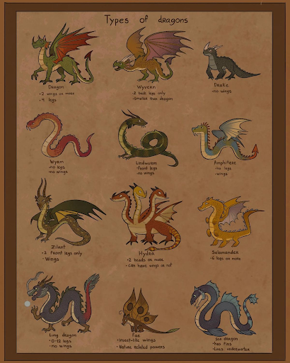
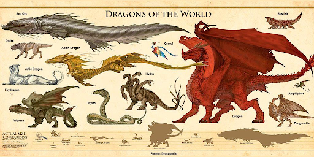
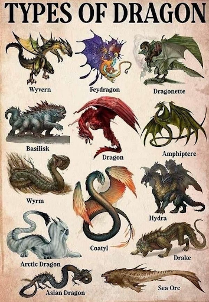

---

## 3. Catálogo Completo das 16 Raças (1 por MBTI)

### 🟣 Grupo dos Analistas (`NT` — Foco em Magia, Estratégia e Alcance)
| MBTI | Raça do Dragão | Anatomia Base | Cabeça / Asas / Cauda | Especialidade |
| :--- | :--- | :--- | :--- | :--- |
| **INTJ** | **Draco Arcano** *(Dragon Clássico)* | 4 patas + 2 asas grandes (porte majestoso) | Cabeça `H` • Asa `Fingered` • Cauda `Sword` | Dano elemental massivo à distância e alta precisão mágica. |
| **INTP** | **Lung Celestial** *(Asian Dragon)* | Corpo serpentino longo, sem asas (levitação mágica) | Cabeça `G` • Padrão `F` • Cauda `Heaven` | Regeneração de mana/estamina rúnica e controle de área. |
| **ENTJ** | **Hidra Soberana** *(Hydra)* | Corpo pesado multi-cabeças (2 a 3 cabeças) com asas | Cabeça `B` • Asa `Handed` • Cauda `Morningstar` | Ataques múltiplos simultâneos e intimidação de inimigos. |
| **ENTP** | **Anfíptero Ilusório** *(Amphiptere)* | Corpo serpentino sem patas, sustentado por 2 asas enormes | Cabeça `E` • Asa `Accordion` • Cauda `Dagger` | Esquiva aérea, rajadas rápidas e truques elementais. |

### 🟢 Grupo dos Diplomatas (`NF` — Foco em Vínculo, Suporte e Cura)
| MBTI | Raça do Dragão | Anatomia Base | Cabeça / Asas / Cauda | Especialidade |
| :--- | :--- | :--- | :--- | :--- |
| **INFJ** | **Coatyl Místico** *(Coatyl)* | Serpente emplumada com asas de ave/plumas | Cabeça `J` • Padrão `H` • Cauda `Feather` | Auras de purificação, cura passiva e resistência mágica. |
| **INFP** | **Dragão Feérico** *(Feydragon / Fae)* | Porte esguio com asas estilo mariposa/inseto translúcidas | Cabeça `C` • Padrão `D` • Cauda `River` | Acelera o crescimento de plantas mágicas na fazenda e restaura energia. |
| **ENFJ** | **Serpe Solar** *(Zilant)* | 2 patas dianteiras + asas largas (postura erguida) | Cabeça `K` • Asa `6-Fingered` • Cauda `Heaven` | Buffa o ataque e a defesa do jogador quando lutam próximos. |
| **ENFP** | **Dragonete Etéreo** *(Dragonette)* | Porte médio/ágil, 4 patas leves e asas largas vibrantes | Cabeça `A` • Padrão `F` • Cauda `Fire` | Aumenta a sorte em coletas raras e reduz o custo de impulso no ar. |

### 🔵 Grupo dos Sentinelas (`SJ` — Foco em Defesa, Fazenda e Carga)
| MBTI | Raça do Dragão | Anatomia Base | Cabeça / Asas / Cauda | Especialidade |
| :--- | :--- | :--- | :--- | :--- |
| **ISTJ** | **Basilisco Blindado** *(Basilisk)* | Corpo baixo e largo, 6 patas, couraça dorsal espinhosa | Cabeça `I` • Cauda `Club` (Clava) | Defesa física extrema e imunidade a atordoamento. |
| **ISFJ** | **Dragão Ártico** *(Arctic Dragon)* | Corpo robusto adaptado ao frio, pelagem/escamas densas | Cabeça `D` • Padrão `J` • Cauda `Deep Sea` | Protege o jogador com barreiras de gelo/escudo e resiste a climas hostis. |
| **ESTJ** | **Salamandra de Guerra** *(Salamander)* | 6 patas musculosas + asas médias (tração máxima) | Cabeça `F` • Asa `Handed` • Cauda `Battle` | Maior capacidade de carga da sela (ideal para mineração e colheita). |
| **ESFJ** | **Leviatã das Marés** *(Sea Dragon)* | Corpo aquático com barbatanas dorsais e membrana de planagem | Cabeça `K` • Asa `Rayed` • Cauda `River` | Irrigação automática de áreas da fazenda e deslocamento aquático rápido. |

### 🟡 Grupo dos Exploradores (`SP` — Foco em Velocidade, Crítico e Combate Físico)
| MBTI | Raça do Dragão | Anatomia Base | Cabeça / Asas / Cauda | Especialidade |
| :--- | :--- | :--- | :--- | :--- |
| **ISTP** | **Draco Terrestre** *(Drake)* | 4 patas musculosas, sem asas (saltos gigantes e corrida) | Cabeça `B` • Cauda `Scorpion` (Ferrão) | Dano físico brutal, quebra de armadura e velocidade no solo. |
| **ISFP** | **Wyvern Silvestre** *(Wyvern)* | 2 patas traseiras + asas que funcionam como braços no chão | Cabeça `A` • Padrão `C` • Cauda `Mountain` | Manobrabilidade ágil entre árvores, montanhas e desfiladeiros. |
| **ESTP** | **Wyrm Predador** *(Wyrm)* | Corpo serpentino gigante e ágil, sem patas ou asas | Cabeça `E` • Cauda `Sword` | Emboscadas rápidas, dano crítico alto e perfuração de defesas. |
| **ESFP** | **Lindwurm Veloz** *(Lindwurm)* | Corpo serpentino com 2 patas dianteiras fortes e garras afiadas | Cabeça `H` • Padrão `I` • Cauda `Dagger` | Ataques em sequência velozes e alta taxa de crítico em movimento. |

---

## 4. Módulos Anatômicos & Customização (Para Modelagem 3D e Shaders)

### 4.1. Ovos do Santuário (Fase 1 & 2)
O ovo muda de casca conforme a raça invocada e o elemento da rota do parkour (escamas sobrepostas para Fogo, casca lisa/cristalina para Água, espinhos/casca rochosa para Terra, filamentos plumosos para Vento):

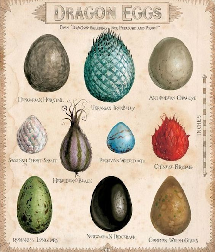

### 4.2. Morfologia de Cabeças (`A` a `K`)
Cada raça utiliza um dos arquétipos cranianos abaixo como base de *rigging* facial e chifres:

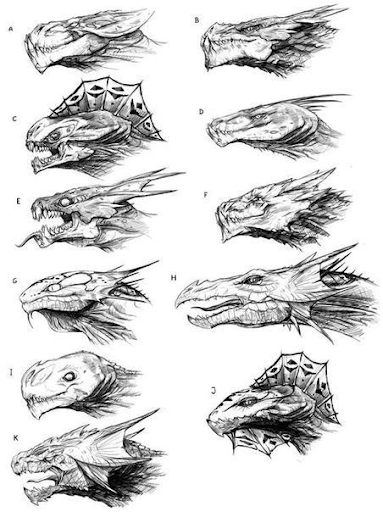

### 4.3. Anatomia e Padrões de Asas
* **Estrutura Óssea (Rigging de Voo):** *Fingered* (padrão), *Rayed* (aquático/planador), *6-Fingered* (alta sustentação), *Accordion* (acrobático) e *Handed* (apoio terrestre):
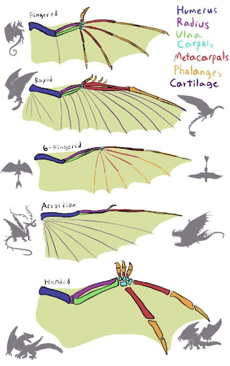

* **Padrões de Membrana (`A` a `K`) e Paletas Elementais:**
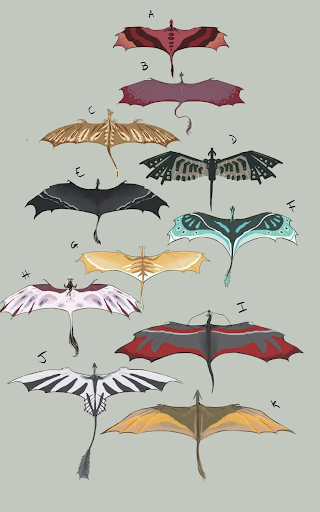
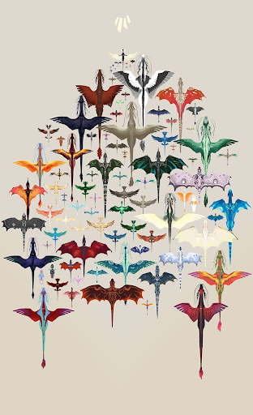

* **Postura Terrestre de Wyverns (Apoio nas Asas):**
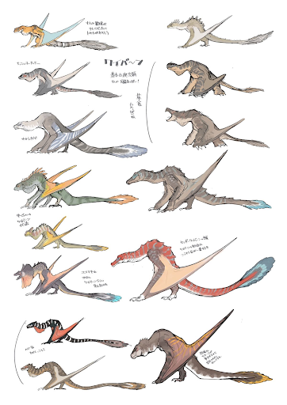

### 4.4. Caudas & Armas Naturais
As caudas definem o ataque secundário e o equilíbrio em voo:
* **Elementais:** *Fire Dragon* (I), *Battle Fighter* (II), *River Dragon* (III), *Mountain Beast* (IV), *Deep Sea Monster* (V), *Creature of Heaven* (VI).
* **Bélicas:** *Club Tail*, *Scorpion Tail*, *Dagger Tail*, *Sword Tail*, *Morningstar Tail*, *Feather Tail*.

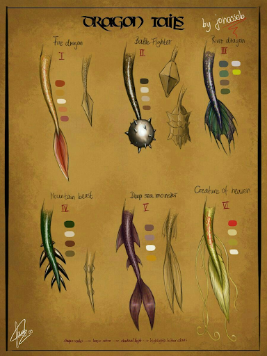
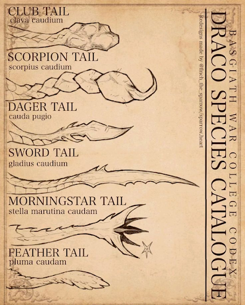

### 4.5. Íris e Expressão Ocular (Personalidade & Traço)
A pupila e o brilho ocular refletem o traço psicológico do dragão (pupila fendida para predadores/audaciosos, redonda para protetores/dóceis, estrelada/rúnica para linhagens místicas):

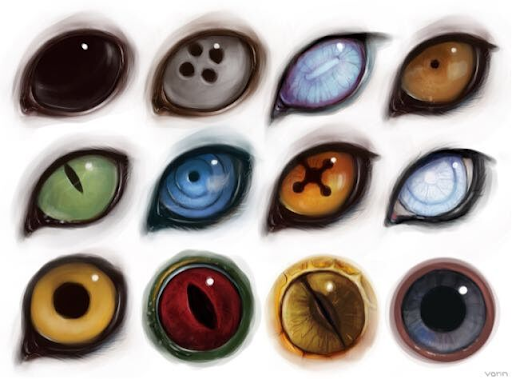

---

## 5. Estrutura de Pastas das Imagens no Repositório

As 12 imagens de referência estão incluídas em `docs/assets/references/`:

```text
docs/
├── ONBOARDING_DRAGOES_ARTE_E_SISTEMA.md
└── assets/
    └── references/
        ├── ref_01_wyvern_posture_study.png
        ├── ref_02_dragon_eggs.png
        ├── ref_03_dragon_heads_ak.png
        ├── ref_04_wing_patterns_ak.png
        ├── ref_05_topdown_silhouettes.png
        ├── ref_06_dragon_eyes.png
        ├── ref_07_types_of_dragons.png
        ├── ref_08_dragon_tails_color.png
        ├── ref_09_dragon_tails_catalogue.png
        ├── ref_10_dragons_of_the_world_scale.png
        ├── ref_11_types_of_dragon_alt.png
        └── ref_12_wing_anatomy.png
```
