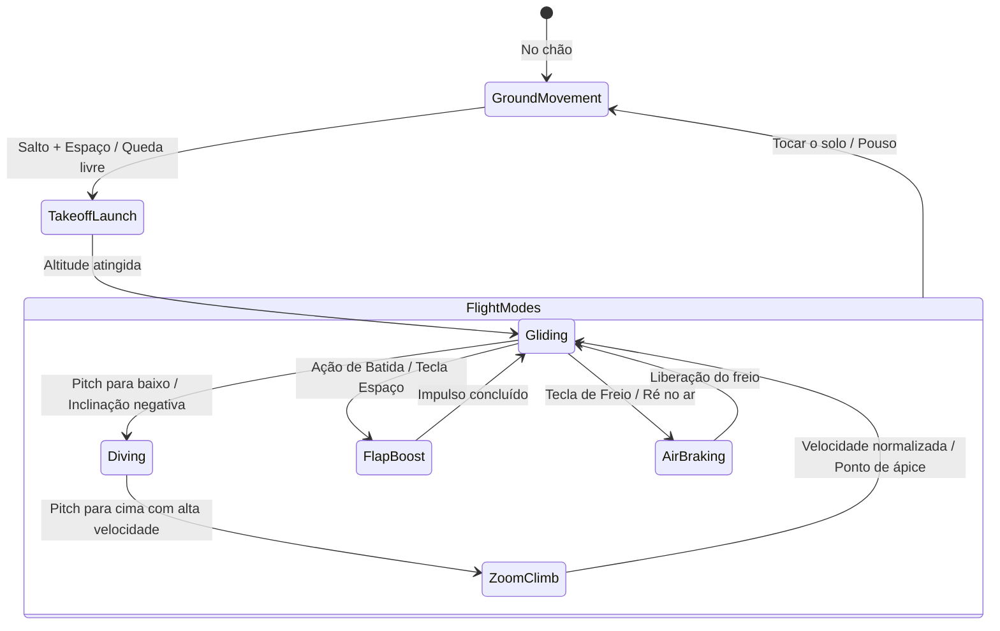

# 🦅 Onboarding Técnico: Mecânica de Voo Fluido & Dinâmico (Flight System 2.0)

**Repositório:** `mokamozu/Dragons_lair`  
**Engine:** Godot 4.3+  
**Alvo:** `CharacterBody3D` (`DragonController`), `Camera3D` (`ThirdPersonCamera`), Shaders de Vento e Áudio Dinâmico.  
**Inspiração:** *Dragonriding* (WoW), mecânica de Grifo (*Guild Wars 2*), *How to Train Your Dragon*.

---

## 1. Visão Geral da Experiência

O voo em *Dragons Lair* deixa de ser uma movimentação noclip em eixos X/Y/Z para se tornar uma **física aerodinâmica com conservação de momentum**, onde o jogador sente peso, sustentação, inércia e velocidade:

* **Mergulho (Dive) $\rightarrow$ Carga de Velocidade:** Apontar para baixo troca altitude por velocidade cinética terminal.
* **Elevação (Pitch Up) $\rightarrow$ Conversão Cinética:** Puxar o nariz para cima converte a velocidade do mergulho em altitude súbita (*zoom climb*).
* **Impulsos de Batida (Flap Boost):** Batidas ritmadas consomem estamina para gerar empuxo (*thrust*).
* **Planagem Estável (Glide):** Sem comandos, o dragão corta o ar com consumo mínimo de energia.
* **Freio Aéreo (Air Brake):** Abrir as asas perpendicularmente para desacelerar rápido e fechar o raio de curva.
* **Sensação Cinestésica (Game Feel):** FOV dinâmico, câmera com inércia (*spring arm* elástico), efeito visual de túnel de vento (linhas de ar) e áudio de vento modulado por velocidade.

---

## 2. Máquina de Estados de Voo (Flight FSM)

---

## 3. Modelo Físico & Aerodinâmico

O controlador calcula a velocidade vetorial baseando-se em 4 forças fundamentais a cada `_physics_process(delta)`:

$$\vec{F}_{\text{total}} = \vec{F}_{\text{thrust}} + \vec{F}_{\text{lift}} + \vec{F}_{\text{gravity}} + \vec{F}_{\text{drag}}$$

### 3.1. Vetor de Empuxo ($\vec{F}_{\text{thrust}}$)
Força gerada para frente ao longo do eixo `forward` do dragão:
* Durante planagem base: Empuxo de cruzeiro ($v_{\text{cruise}} \approx 14\,m/s$).
* Durante **Flap Boost**: Pulso de aceleração instantâneo ($+12\,m/s$) com custo de estamina.

### 3.2. Carga de Velocidade por Mergulho (Massa & Gravidade)
Ao mergulhar ($\text{pitch} < 0$):
* A aceleração da gravidade projeta componente positiva no vetor `forward`.
* A velocidade terminal pode alcançar até $38\,m/s$ (3× a velocidade padrão de cruzeiro).
* Acumula a variável `kinetic_charge` ($0.0$ a $1.0$).

### 3.3. Sustentação e Conversão de Momentum (Lift)
Ao puxar o nariz para cima ($\text{pitch} > 0$):
* Se `velocity.length() > v_cruise`: Converte `kinetic_charge` em aceleração vertical ascendente até o ápice da parábola.
* Se a velocidade cair abaixo de $v_{\text{stall}} \approx 5\,m/s$: Ocorre **Estol (Stall)** — asas perdem sustentação e o dragão entra em queda livre até retomar fluxo de ar apontando o nariz para baixo.

### 3.4. Arrasto e Freio Aéreo (Drag & Air Brake)
* Arrasto parasita natural proporcional a $v^2$.
* Acionamento do **Air Brake**: Multiplica o arrasto por $4.5$, aciona animação de asas abertas em concha e reduz a velocidade até $v_{\text{cruise}}$ permitindo curvas de $180^\circ$ rápidas.

---

## 4. Dinâmica de Curvas, Roll e Banking

Para evitar movimentação mecânica de "robô", a malha 3D reage à velocidade angular:

1. **Roll Orgânico (Bancagem):**
   $$\text{Roll Target} = -\text{turn\_input} \times \text{clamp}\left(\frac{v}{v_{\text{cruise}}}, 0.5, 1.8\right) \times 45^\circ$$
   Nas curvas em alta velocidade, o dragão inclina as asas em até $65^\circ$.
2. **Pitch Reativo:**
   O nariz sobe levemente no final da curva para manter sustentação centrípeta.
3. **Inércia e Deriva (Slip & Drift):**
   Em altas velocidades, a direção do movimento não alinha imediatamente com a rotação, criando uma leve deriva aerodinâmica fluida.

---

## 5. Diferenciação por Taxonomia (As 4 Raças Elementais)

As características de voo escalam conforme a espécie do dragão (Issue #1 e #2):

| Tipo Elemental | Perfil Aerodinâmico | Velocidade Terminal | Custo de Impulso | Manobrabilidade (Roll/Turn) | Período de Flap |
| :--- | :--- | :--- | :--- | :--- | :--- |
| **Serpe (Vento)** | *Planador de Alta Altitude* | **$42\,m/s$** | Baixo (-35%) | **Excelente (Ágil)** | Rápido e suave |
| **Draco (Fogo)** | *Bombardeiro de Mergulho* | $38\,m/s$ | Moderado | Moderada | Potente e explosivo |
| **Wyvern (Terra)** | *Voo Pesado & Sustentação* | $28\,m/s$ | Elevado (+25%) | Pesada (Estável) | Lento com forte deslocamento |
| **Leviatã (Água)** | *Efeito Solo & Planador Marinho* | $32\,m/s$ | Baixo perto da água | Fluida (Ondulada) | Membrana estilo arraia |

---

## 6. Feedback Audiovisual & Câmera (Game Feel)

1. **Câmera Dinâmica (Dynamic FOV & Distance):**
   * Em repouso: $\text{FOV} = 70^\circ$, distância da câmera $= 5.0\,m$.
   * Em mergulho / alta velocidade ($35+ m/s$): $\text{FOV} \rightarrow 92^\circ$, distância $\rightarrow 7.5\,m$.
   * Câmera com amortecimento elástico (*smooth spring lag*): a aceleração empurra o dragão momentaneamente para frente no quadro antes da câmera acompanhar.
2. **Efeitos Visuais (VFX):**
   * *Wind Ribbons (Linhas de Vácuo):* Rastros de ar nas pontas das asas que ativam a partir de $22\,m/s$.
   * *Screen Distortion Shader:* Leve aberração cromática e vinheta nas bordas da tela durante o impulso máximo.
   * *Penas / Poeira:* Partículas de turbulência e impacto de ar ao bater as asas próximo ao solo.
3. **Áudio Dinâmico (SFX):**
   * Som de vento modulado em pitch e volume via parâmetro linear ligado a `velocity.length()`.
   * Som de chicotada de ar ao cortar ventos fortes ou ativar o *Air Brake*.
