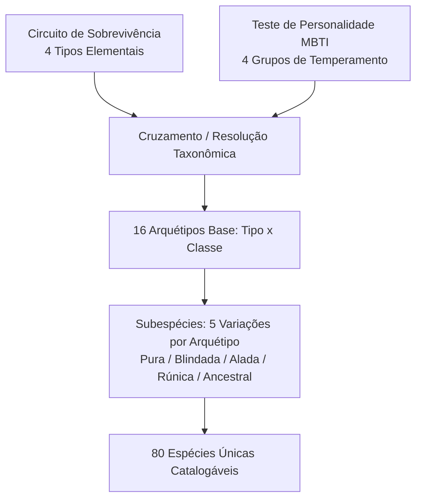

# [FEATURE] Arquitetura de Dados e Matriz Taxonômica das Raças de Dragão (Matriz 4 × 4 × 5)

## 🎯 Objetivo
Implementar a arquitetura de dados e o sistema de resolução/geração procedural e determinística das **raças de dragão** no Godot 4, cruzando o resultado do **Circuito de Sobrevivência (4 Tipos Elementais)** com o **Teste do Mago (4 Grupos MBTI)** e desbloqueando **5 variações de espécies** dentro de cada combinação (totalizando **80 espécies catalogáveis**).

A nova arquitetura substitui o dicionário estático `RACE_DATA` do prólogo por uma estrutura modular extensível orientada a `Resource` (`DragonSpeciesData` e `DragonInstanceData`), desacoplando metadados visuais/mecânicos da instância individual do jogador.

---

## 🧬 Estrutura Taxonômica (Matriz 4 × 4 × 5 = 80 Espécies)



### Eixo 1: Os 4 Tipos Elementais (Definidos pela Rota no Parkour)
1. **Serpe (Vento / Raio)** – *Rota das Correntes*
   * **Foco:** Velocidade Aérea, Agilidade de Voo e Estamina.
2. **Draco (Fogo)** – *Rota das Brasas*
   * **Foco:** Dano Elemental, Ataque Direto e Crítico.
3. **Wyvern (Terra)** – *Rota das Raízes*
   * **Foco:** Vitalidade, Defesa Física e Capacidade de Carga.
4. **Leviatã (Água / Gelo)** – *Rota das Marés*
   * **Foco:** Regeneração, Esquiva Aquática/Terrestre e Controle.

### Eixo 2: As 4 Classes de Temperamento (Definidas pelo Grupo MBTI do Dragão)
Cada um dos 4 Tipos Elementais se subdivide em **4 Classes de Temperamento**:
1. **Classe Soberana — Analistas (`NT`: INTJ, INTP, ENTJ, ENTP)**
   * *Perfil:* Estratégicos, focados em magia e alcance, alto intelecto tático e poder elemental refinado.
2. **Classe Etérea — Diplomatas (`NF`: INFJ, INFP, ENFJ, ENFP)**
   * *Perfil:* Empáticos, suporte, vínculo afetivo acelerado, auras de cura e sinergia de combate.
3. **Classe Bastião — Sentinelas (`SJ`: ISTJ, ISFJ, ESTJ, ESFJ)**
   * *Perfil:* Disciplinados, leais, tanques naturais, bônus defensivos em área e produtividade (transporte/trabalho).
4. **Classe Predadora — Exploradores (`SP`: ISTP, ISFP, ESTP, ESFP)**
   * *Perfil:* Instintivos, reflexos rápidos, foco em dano físico, esquiva, combate corpo a corpo e aceleração súbita.

### Eixo 3: As 5 Variações por Arquétipo (Total: 80 Espécies Catalogáveis)
Para cada uma das 16 combinações (Tipo × Classe), existem **5 variações morfológicas/genéticas** distintas:
* **Variação 1 (Comum / Pura):** Linhagem equilibrada do santuário ancestral.
* **Variação 2 (Subterrânea / Blindada):** Placas ósseas espessas, massa corporal elevada, bônus de Armadura/Defesa.
* **Variação 3 (Alada / Esguia):** Envergadura ampliada, membranas aerodinâmicas, velocidade e planeio otimizados.
* **Variação 4 (Rúnica / Mística):** Cristais ou glifos bioluminescentes, afinidade com status elementais e custo de mana/fôlego reduzido.
* **Variação 5 (Ancestral / Rara):** Coroa de chifres exclusiva, cauda modificada, passiva assinatura e modificadores estatísticos de elite.

---

## 🛠️ Especificação Técnica (Godot 4)

### 1. Estrutura de Arquivos e Pastas
```text
godot_project/
├── data/
│   └── dragons/
│       ├── vento/              # 20 .tres (4 classes × 5 variações)
│       ├── fogo/               # 20 .tres
│       ├── terra/              # 20 .tres
│       └── agua/               # 20 .tres
└── src/
    ├── resources/
    │   ├── dragon_species_data.gd    # Resource estático da espécie (base stats, modelo, ícone, perks)
    │   └── dragon_instance_data.gd   # Resource da instância viva (MBTI, apelido, XP, vínculo, IVs)
    └── systems/
        ├── dragon_taxonomy_registry.gd # Singleton/Registry para indexação dos 80 .tres e lookup rápido
        └── dragon_factory.gd           # Geração determinística (Elemento + MBTI + Identidade/Seed -> Espécie)
```

### 2. Definição dos Resources

#### `DragonSpeciesData` (`res://src/resources/dragon_species_data.gd`)
```gdscript
class_name DragonSpeciesData
extends Resource

enum ElementalType { VENTO, FOGO, TERRA, AGUA }
enum TemperamentClass { SOBERANA_NT, ETEREA_NF, BASTIAO_SJ, PREDADORA_SP }
enum MorphologyVariation { PURA, BLINDADA, ALADA, RUNICA, ANCESTRAL }

@export_group("Taxonomia")
@export var id: String = ""                           # Ex: "vento_nt_ancestral"
@export var species_name: String = ""                 # Ex: "Serpe Soberana Primordial"
@export var elemental_type: ElementalType = ElementalType.VENTO
@export var temperament_class: TemperamentClass = TemperamentClass.SOBERANA_NT
@export var variation: MorphologyVariation = MorphologyVariation.PURA
@export_multiline var lore_description: String = ""

@export_group("Visual e Áudio")
@export var model_scene: PackedScene                  # Mesh/Rig específico ou variações de partes
@export var base_texture: Texture2D
@export var icon: Texture2D
@export var roar_sound: AudioStream

@export_group("Atributos Base")
@export var base_max_hp: float = 120.0
@export var base_max_stamina: float = 100.0
@export var base_elemental_power: float = 15.0
@export var base_physical_strength: float = 10.0
@export var base_carry_capacity: float = 40.0
@export var base_flight_speed: float = 1.0
@export var base_turn_agility: float = 1.0
@export var base_critical_chance: float = 0.05
@export var base_stamina_regen: float = 1.0

@export_group("Perks & Passivas")
@export var passive_id: String = ""
@export var passive_description: String = ""
@export var heat_resistance: bool = false
@export var swim_multiplier: float = 1.0
```

#### `DragonInstanceData` (`res://src/resources/dragon_instance_data.gd`)
```gdscript
class_name DragonInstanceData
extends Resource

@export var nickname: String = ""
@export var species_data: DragonSpeciesData
@export var player_mbti: String = "ENFP-A"
@export var dragon_mbti: String = "INTJ-A"
@export var identity_suffix: String = "A"             # 'A' (Assertivo) ou 'T' (Turbulento)

# Vínculo e Progressão
@export var current_hp: float = 100.0
@export var level: int = 1
@export var current_xp: int = 0
@export var bond_affection: float = 10.0
@export var exhaustion_state: bool = false

# Individual Values / Mutações
@export var scale_modifier: float = 1.0
@export var pigment_tint: Color = Color.WHITE

func build_runtime_stats() -> DragonStats:
    # Compõe os status do DragonSpeciesData com bônus de temperamento e afinidade
    pass
```

### 3. Sistema de Geração (`DragonFactory` / `DragonTaxonomyRegistry`)
- Mapeamento determinístico:
  - **Rota do Parkour (0..3)** $\rightarrow$ `ElementalType` (Vento, Fogo, Terra, Água).
  - **Tipo MBTI do Dragão (16 tipos)** $\rightarrow$ Agrupado em `TemperamentClass` (`NT`, `NF`, `SJ`, `SP`).
  - **Identidade & Condição no Ritual** $\rightarrow$ Determina a `MorphologyVariation`:
    - Padrão do Prólogo: Assertivo (`-A`) tende a variações Aladas/Rúnicas, Turbulento (`-T`) tende a variações Blindadas/Místicas, com Variação Ancestral desbloqueada por critérios especiais (ex: desempenho perfeito na rota ou sinergia de afinidade rara).
- Construtor de lookup determinístico `DragonTaxonomyRegistry.get_species(type, temperament, variation)`.

### 4. Integração com o Prólogo Existente
- Atualizar `res://src/prologue/ritual_controller.gd`:
  - Substituir o array `RACE_DATA` estático pela consulta ao `DragonTaxonomyRegistry`.
  - Instanciar e preencher o `DragonInstanceData` ao concluir o ritual.
  - Manter retrocompatibilidade com `DragonData` e o teste automatizado em `res://tests/ritual_smoke_test.gd`.

---

## 📋 Lista de Tarefas / Checklist de Implementação

- [ ] **Módulo de Definição (Resources)**
  - [ ] Criar `res://src/resources/dragon_species_data.gd` com Enums e exports tipados.
  - [ ] Criar `res://src/resources/dragon_instance_data.gd` com métodos de instanciação e cálculo de status.
- [ ] **Registro e Catálogo (Data Registry)**
  - [ ] Criar `res://src/systems/dragon_taxonomy_registry.gd` (cache e indexação em dicionário ou autoload).
  - [ ] Criar script utilitário (`tool`) ou gerador batch para gerar os 80 arquivos `.tres` de espécies organizados em `res://data/dragons/{vento,fogo,terra,agua}/`.
- [ ] **Fábrica e Resolução Determinística**
  - [ ] Implementar `res://src/systems/dragon_factory.gd` contendo a regra de cruzamento:
    - `resolve_species(route_id: int, mbti_code: String, identity: String, score_bonus: float) -> DragonSpeciesData`.
- [ ] **Integração no Fluxo de Jogo**
  - [ ] Integrar no `res://src/prologue/ritual_controller.gd` no método `_bond_with_dragon()`.
  - [ ] Conectar os dados gerados à UI de sumário final (`_show_summary_screen()`).
- [ ] **Testes Automatizados e Validação**
  - [ ] Atualizar ou estender `res://tests/ritual_smoke_test.gd` para cobrir os 16 arquétipos base e as 5 variações (80 combinações sem erros de lookup).
  - [ ] Validar serialização/salvamento com `ResourceSaver.save()`.

---

## 🎯 Critérios de Aceite
1. Todas as 80 combinações da matriz 4 × 4 × 5 possuem uma entrada válida e carregável via `ResourceLoader`.
2. A rota do parkour seleciona confiavelmente o tipo elemental correspondente.
3. O MBTI resultante do Teste do Mago agrupa corretamente na classe correspondente (`NT`, `NF`, `SJ`, `SP`).
4. Nenhuma referência a `RACE_DATA` estático quebrará testes existentes de inicialização.
5. A cobertura dos testes automatizados valida que a espécie resolvida contém nomes, status e perks distintos.
