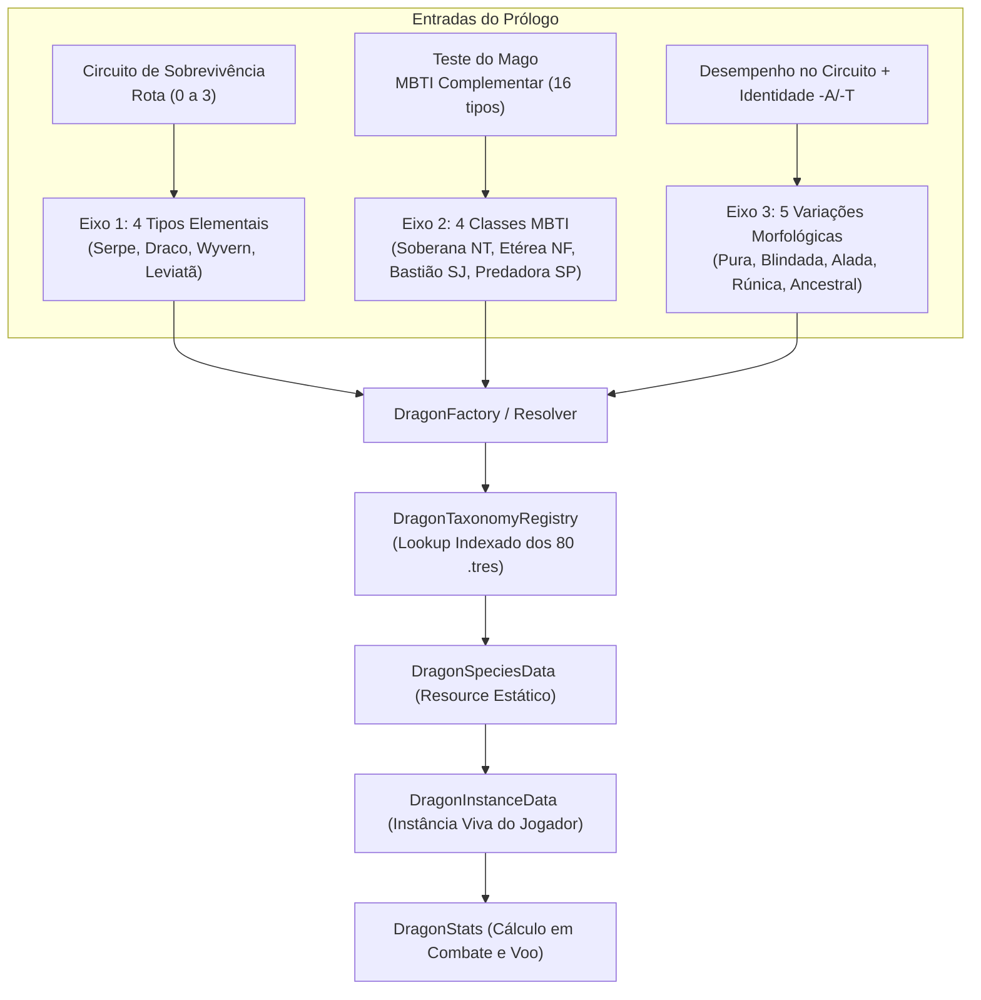

# [FEATURE] Arquitetura de Dados e Matriz Taxonômica das Raças de Dragão (Matriz 4 × 4 × 5)

## 🎯 Objetivo
Implementar a arquitetura de dados e o sistema de resolução/geração procedural e determinística das **raças de dragão** no Godot 4, cruzando o resultado do **Circuito de Sobrevivência (4 Tipos Elementais)** com o **Teste do Mago (4 Grupos MBTI)** e desbloqueando **5 variações de espécies** dentro de cada combinação (totalizando **80 espécies catalogáveis**).

A nova arquitetura substitui o dicionário estático `RACE_DATA` do prólogo por uma estrutura modular extensível orientada a `Resource` (`DragonSpeciesData` e `DragonInstanceData`), desacoplando metadados visuais/mecânicos da instância individual do jogador e garantindo compatibilidade contínua com `DragonData` e o pipeline de salvamento existente.

---

## 🧬 Estrutura Taxonômica (Matriz 4 × 4 × 5 = 80 Espécies)



### Eixo 1: Os 4 Tipos Elementais (Definidos pela Rota do Parkour)
Determinados pela canaleta/rota percorrida no `SurvivalCourse`:
1. **Serpe (Vento / Raio)** – *Caminho das Correntes (Rota 0)*
   * **Bases:** +40 Estamina, +15% Velocidade Aérea, -20% Custo de Voo.
2. **Draco (Fogo)** – *Caminho das Brasas (Rota 1)*
   * **Bases:** +15 Poder Elemental, +10% Dano Crítico, Imunidade/Resistência a Calor.
3. **Wyvern (Terra)** – *Caminho das Raízes (Rota 2)*
   * **Bases:** +50 Vitalidade Máxima, +40 Capacidade de Carga, Bônus de Armadura Física.
4. **Leviatã (Água / Gelo)** – *Caminho das Marés (Rota 3)*
   * **Bases:** +25% Regeneração de Fôlego, +20% Agilidade de Curva, +50% Velocidade de Nado.

### Eixo 2: As 4 Classes de Temperamento (Definidas pelo Grupo MBTI)
O MBTI complementar do dragão gerado no `MagePersonalityTest` é agrupado por seu núcleo funcional:
1. **Classe Soberana — Analistas (`NT`: INTJ, INTP, ENTJ, ENTP)**
   * *Foco Mecânico:* Mágico / Tático / Artilharia.
   * *Bônus:* +15% Poder Elemental, +20% Alcance de Disparo de Sopro, redução do consumo de mana/fôlego elemental.
2. **Classe Etérea — Diplomatas (`NF`: INFJ, INFP, ENFJ, ENFP)**
   * *Foco Mecânico:* Suporte / Simbiose / Cura.
   * *Bônus:* +30% Ganho de Afeição/Vínculo, Aura de Regeneração passiva para montaria e cavaleiro, bônus de recuperação de fadiga.
3. **Classe Bastião — Sentinelas (`SJ`: ISTJ, ISFJ, ESTJ, ESFJ)**
   * *Foco Mecânico:* Tanque / Guarda / Produtividade.
   * *Bônus:* +25% Resistência a Dano Físico, +35% Capacidade de Carga de recursos da fazenda, imunidade a recuo (*stagger*).
4. **Classe Predadora — Exploradores (`SP`: ISTP, ISFP, ESTP, ESFP)**
   * *Foco Mecânico:* Combate Corpo a Corpo / Velocidade / Esquiva.
   * *Bônus:* +15% Velocidade Terrestre/Aceleração, +15% Chance de Crítico Físico, manobras evasivas imediatas.

### Eixo 3: As 5 Variações Morfológicas por Combinação
Para cada uma das 16 combinações (4 Elementos × 4 Classes), existem 5 subespécies com identidades visuais e especializações distintas:

| Variação | Nomenclatura / Sufixo | Perfil Visual | Modificador de Atributos | Regra de Desbloqueio no Ritual |
| :--- | :--- | :--- | :--- | :--- |
| **V1: Pura** | *Comum / Primordial* | Proporções clássicas e equilibradas | Atributos balanceados da linhagem | Conclusão regular do percurso sem extremos |
| **V2: Blindada** | *Couraçada / Férrea* | Placas ósseas proeminentes, silhueta pesada | +25% Defesa / Armadura, -5% Velocidade | Jogador recebeu dano na rota OU dragão `-T` com ênfase defensiva |
| **V3: Alada** | *Esguia / Céfiro* | Envergadura alongada, membranas finas | +15% Velocidade de Voo, +10% Agilidade | Tempo de conclusão abaixo de 50% do limite e dragão `-A` |
| **V4: Rúnica** | *Mística / Cristalina* | Glifos bioluminescentes nas asas/escamas | +15% Poder Mágico, +15% Eficiência Elemental | Acerto em todos os alvos opcionais / cristais do percurso |
| **V5: Ancestral** | *Titânica / Alfa* | Coroa de chifres exclusiva, cauda modificada, brilho dourado/fumaça | +20% HP, +10% Dano Geral, Passiva Rara | Percurso sem danos + alvos acertados + sinergia alta no teste |

> **Total da Matriz:** 4 Tipos Elementais × 4 Classes de Temperamento × 5 Variações = **80 Espécies Únicas Catalogáveis**.

---

## 📐 Regras de Nomenclatura Sistemática (80 Espécies)

A nomenclatura é gerada através da fórmula determinística:
$$\text{Nome da Espécie} = \text{[Raça Base]} + \text{" "} + \text{[Epíteto de Classe]} + \text{" "} + \text{[Qualificador de Variação]}$$

* **Exemplos práticos:**
  * Vento + NT + Alada $\rightarrow$ *Serpe Soberana Céfiros*
  * Fogo + SP + Blindada $\rightarrow$ *Draco Predador Couraçado*
  * Terra + SJ + Ancestral $\rightarrow$ *Wyvern Bastião Titânico*
  * Água + NF + Rúnica $\rightarrow$ *Leviatã Etéreo Cristalino*

---

## 🛠️ Especificação Técnica da Arquitetura Godot 4

### 1. Estrutura de Pastas e Recursos
```text
godot_project/
├── data/
│   └── dragons/
│       ├── vento/              # 20 arquivos .tres (4 classes × 5 variações)
│       ├── fogo/               # 20 arquivos .tres
│       ├── terra/              # 20 arquivos .tres
│       └── agua/               # 20 arquivos .tres
└── src/
    ├── resources/
    │   ├── dragon_species_data.gd    # Resource estático da espécie (base stats, assets, passiva)
    │   ├── dragon_instance_data.gd   # Resource da instância viva (vínculo, status atuais, XP, IVs)
    │   └── dragon_data.gd            # Adapter mantido para compatibilidade do prólogo
    └── systems/
        ├── dragon_taxonomy_registry.gd # Singleton/Registry com dicionário indexado e pré-carregamento
        ├── dragon_factory.gd           # Resolvedor determinístico (Rota + MBTI + Desempenho -> Espécie)
        └── tools/
            └── dragon_species_generator.gd # Tool script (@tool) para gerar/atualizar os 80 .tres em lote
```

### 2. Contratos de Código

#### `DragonSpeciesData` (`res://src/resources/dragon_species_data.gd`)
```gdscript
class_name DragonSpeciesData
extends Resource

enum ElementalType { VENTO = 0, FOGO = 1, TERRA = 2, AGUA = 3 }
enum TemperamentClass { SOBERANA_NT = 0, ETEREA_NF = 1, BASTIAO_SJ = 2, PREDADORA_SP = 3 }
enum MorphologyVariation { PURA = 0, BLINDADA = 1, ALADA = 2, RUNICA = 3, ANCESTRAL = 4 }

@export_group("Taxonomia")
@export var id: String = ""                           # Ex: "vento_soberana_alada"
@export var species_name: String = ""                 # Ex: "Serpe Soberana Céfiros"
@export var elemental_type: ElementalType = ElementalType.VENTO
@export var temperament_class: TemperamentClass = TemperamentClass.SOBERANA_NT
@export var variation: MorphologyVariation = MorphologyVariation.PURA
@export_multiline var lore_description: String = ""

@export_group("Representação Visual e Áudio")
@export var model_scene: PackedScene
@export var texture_albedo: Texture2D
@export var texture_emission: Texture2D
@export var icon: Texture2D
@export var roar_stream: AudioStream

@export_group("Modificadores e Atributos Base")
@export var base_max_hp: float = 120.0
@export var base_max_stamina: float = 100.0
@export var base_elemental_power: float = 15.0
@export var base_physical_strength: float = 10.0
@export var base_carry_capacity: float = 40.0
@export var base_flight_speed_mult: float = 1.0
@export var base_turn_agility_mult: float = 1.0
@export var base_flight_cost_mult: float = 1.0
@export var base_critical_chance: float = 0.05
@export var base_critical_damage_mult: float = 1.5
@export var base_stamina_regen_mult: float = 1.0
@export var base_swim_speed_mult: float = 1.0
@export var heat_resistance: bool = false

@export_group("Habilidade Passiva Assinatura")
@export var passive_id: String = ""
@export var passive_name: String = ""
@export_multiline var passive_description: String = ""
```

#### `DragonInstanceData` (`res://src/resources/dragon_instance_data.gd`)
```gdscript
class_name DragonInstanceData
extends Resource

const DRAGON_STATS_SCRIPT: Script = preload("res://src/systems/dragon_stats.gd")

@export var nickname: String = ""
@export var species_data: DragonSpeciesData
@export var player_mbti: String = "ENFP-A"
@export var dragon_mbti: String = "INTJ-T"
@export var behavioral_trait: String = ""

@export_group("Estado de Jogo")
@export var current_hp: float = 120.0
@export var level: int = 1
@export var current_xp: int = 0
@export var bond_affection: float = 10.0
@export var exhausted_first_day: bool = false

@export_group("Mutações Individuais (IVs)")
@export var scale_multiplier: float = 1.0
@export var pigment_tint: Color = Color.WHITE

func build_runtime_stats() -> DragonStats:
    assert(species_data != null, "DragonSpeciesData não pode ser nulo.")
    var stats: DragonStats = DRAGON_STATS_SCRIPT.new()
    stats.dragon_name = nickname if not nickname.is_empty() else species_data.species_name
    stats.element = _get_element_name(species_data.elemental_type)
    stats.max_hp = species_data.base_max_hp
    stats.max_stamina = species_data.base_max_stamina
    stats.elemental_power = species_data.base_elemental_power
    stats.physical_strength = species_data.base_physical_strength
    stats.carry_capacity = species_data.base_carry_capacity
    stats.agility = 8.0 * species_data.base_turn_agility_mult
    stats.critical_chance = species_data.base_critical_chance
    stats.critical_damage_multiplier = species_data.base_critical_damage_mult
    stats.stamina_regen_multiplier = species_data.base_stamina_regen_mult
    stats.flight_speed_multiplier = species_data.base_flight_speed_mult
    stats.flight_stamina_cost_multiplier = species_data.base_flight_cost_mult
    stats.swim_speed_multiplier = species_data.base_swim_speed_mult
    stats.heat_resistance = species_data.heat_resistance
    stats.bond_affection_multiplier = 1.0 + (bond_affection / 100.0)
    return stats

func _get_element_name(elem: DragonSpeciesData.ElementalType) -> String:
    match elem:
        DragonSpeciesData.ElementalType.VENTO: return "Vento"
        DragonSpeciesData.ElementalType.FOGO: return "Fogo"
        DragonSpeciesData.ElementalType.TERRA: return "Terra"
        DragonSpeciesData.ElementalType.AGUA: return "Água / Gelo"
    return "Neutro"
```

### 3. Gerador Batch de Recursos (`dragon_species_generator.gd`)
Para evitar a criação manual dos 80 arquivos `.tres`:
- Script `@tool` executável via editor ou CLI (`godot --headless -s ...`).
- Aplica as fórmulas balanceadas de status para cada combinação `(tipo, classe, variacao)` e grava em `res://data/dragons/{elemento}/{id}.tres`.
- Permite aos game designers abrir qualquer um dos 80 arquivos no Inspector para ajustes manuais finos sem perda de estrutura.

### 4. Camada de Compatibilidade (Retrocompatibilidade)
- `DragonData` é atualizado para conter uma referência opcional `var species_data: DragonSpeciesData` e um método de conversão `to_instance_data() -> DragonInstanceData`.
- O método `create_dragon_stats()` em `DragonData` continua operacional para que todas as cenas existentes (`combat_arena.gd`, `main.gd`, `hud_controller.gd`) continuem funcionando sem refatorações destrutivas imediatas.

---

## 📋 Checklist de Implementação Passo a Passo

- [ ] **Fase 1: Resources & Estrutura Base**
  - [ ] Implementar `res://src/resources/dragon_species_data.gd`.
  - [ ] Implementar `res://src/resources/dragon_instance_data.gd`.
  - [ ] Atualizar `res://src/resources/dragon_data.gd` com campos de transição.
- [ ] **Fase 2: Catálogo e Gerador dos 80 Recursos**
  - [ ] Criar o script utilitário `res://src/systems/tools/dragon_species_generator.gd`.
  - [ ] Executar o gerador para popular `res://data/dragons/` com os 80 arquivos `.tres`.
  - [ ] Implementar `res://src/systems/dragon_taxonomy_registry.gd` (cache indexado `dict[tipo][classe][variacao]`).
- [ ] **Fase 3: Motor de Resolução Determinística**
  - [ ] Implementar `res://src/systems/dragon_factory.gd`:
    - Resolução de `ElementalType` a partir de `route_index`.
    - Resolução de `TemperamentClass` a partir do `mbti_code` (extração dos eixos centrais `NT`, `NF`, `SJ`, `SP`).
    - Resolução de `MorphologyVariation` com base no tempo, dano recebido e sufixo de identidade (`-A` / `-T`).
- [ ] **Fase 4: Integração com o Ritual do Prólogo**
  - [ ] Atualizar `res://src/prologue/ritual_controller.gd` para utilizar o `DragonFactory`.
  - [ ] Atualizar o sumário pós-ritual (`_show_summary_screen()`) exibindo a nomenclatura completa, classe e variação.
- [ ] **Fase 5: Testes e Validação de Regressão**
  - [ ] Expandir `res://tests/ritual_smoke_test.gd` com suíte de teste taxonômico:
    - Validar que todos os 80 `.tres` existem e carregam sem erros.
    - Testar determinismo: mesmos parâmetros de entrada geram a mesma espécie.
    - Testar integridade dos status calculados em `DragonStats`.

---

## 🎯 Critérios de Aceite
1. **Completude do Catálogo:** Todos os 80 arquivos `.tres` estão presentes na árvore `res://data/dragons/` e passam na verificação de integridade do `ResourceLoader`.
2. **Precisão Determinística:**
   - Rotas 0, 1, 2, 3 mapeiam estritamente para Serpe (Vento), Draco (Fogo), Wyvern (Terra) e Leviatã (Água).
   - Qualquer combinação MBTI de 16 tipos mapeia corretamente para sua respectiva classe (`NT`, `NF`, `SJ`, `SP`).
3. **Estabilidade de Pipeline:** Todos os testes de fumaça existentes (`tests/ritual_smoke_test.gd`) continuam passando sem regressões.
4. **Desempenho:** A indexação no `DragonTaxonomyRegistry` é instantânea no startup, sem causar travamentos ou picos de carregamento durante a transição de fases do prólogo.
